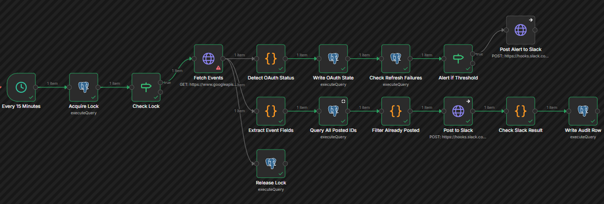
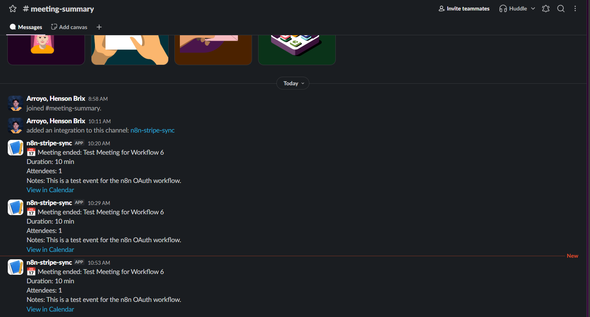
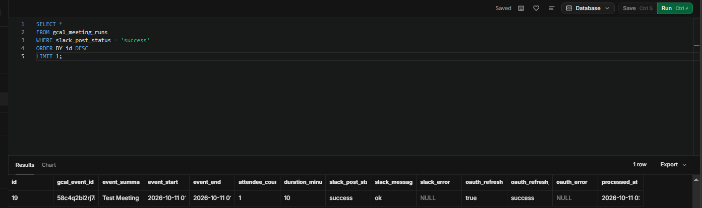
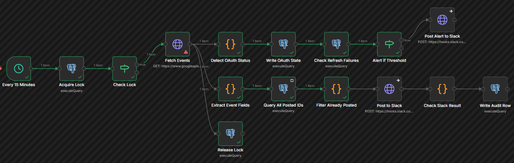
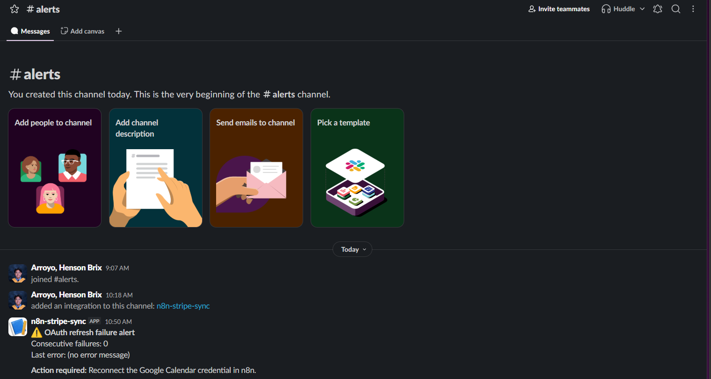
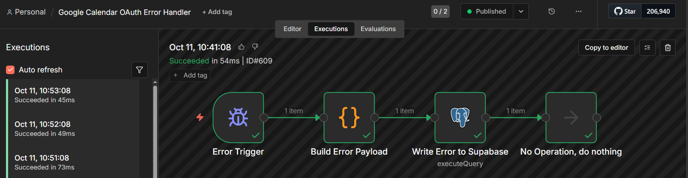
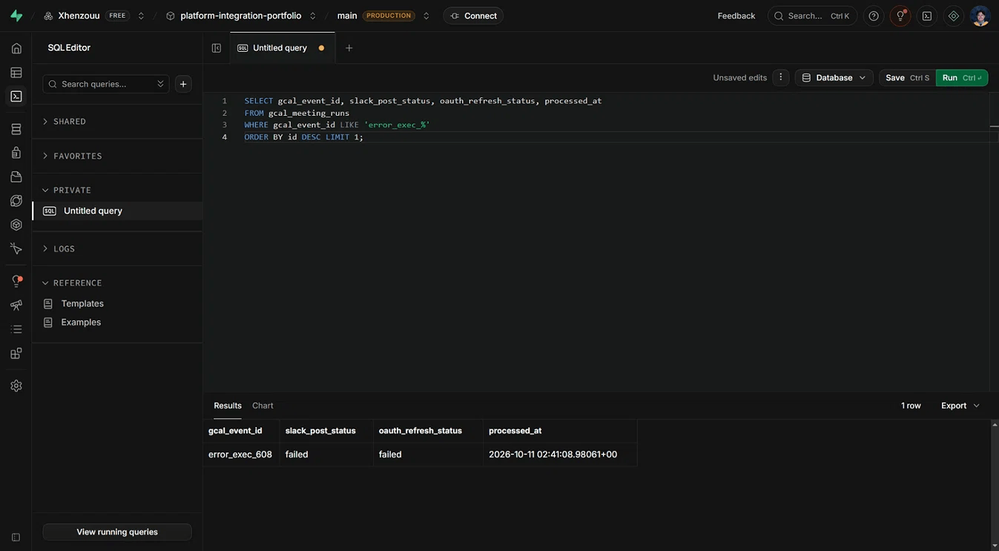

# Workflow 6: Google Calendar → Slack with OAuth Refresh Handling

[← Back to README](../../README.md)

**Status:** Verified end to end. OAuth authorization code flow, token refresh monitoring, idempotent event processing, alert threshold, and companion error handler all confirmed.

## Problem

Scheduled integrations with Google APIs are the most common OAuth 2.0 use case in platform work: a workflow runs on a timer, calls a Google API, and must keep working across the access token's 1-hour lifetime without manual intervention. This is a different problem from the authentication patterns used in earlier workflows. Workflows 1–5 cover static API keys, HMAC signature verification (Shopify, Stripe), client credentials (Shopify admin API), and bearer tokens. Workflow 6 exercises the full OAuth 2.0 authorization code flow with refresh token lifecycle management the credential expires, rotates, and can be revoked, and the workflow must handle all three cases.

The scenario: a team tracks meetings in Google Calendar and wants a summary posted to Slack after each meeting ends. The workflow runs every 15 minutes, fetches events that ended in the last 20 minutes, and posts a summary for each. It must:

- Refresh the OAuth access token without human intervention.
- Detect and record refresh failures so a human can re-authorize when the token is revoked.
- Avoid double-posting when the same event falls within two adjacent runs.
- Alert when the OAuth credential has been broken for three consecutive runs.

This is the OAuth refresh pattern that the portfolio did not previously exercise.

## Architecture

```
Schedule Trigger (every 15 minutes)
→ Acquire Lock (pg_try_advisory_lock)
→ Check Lock
    ├── false → (end)
    └── true  → Fetch Events (Google Calendar API, OAuth2 credential)
                  ├── Detect OAuth Status
                  │     → Write OAuth State
                  │     → Check Refresh Failures
                  │     → Alert if Threshold
                  │          ├── true  → Post Alert to Slack
                  │          └── false → (end)
                  ├── Extract Event Fields
                  │     → Query All Posted IDs
                  │     → Filter Already Posted
                  │     → Post to Slack
                  │     → Check Slack Result
                  │     → Write Audit Row
                  └── Release Lock (pg_advisory_unlock)
```

Error handling lives in a separate workflow (`Google Calendar OAuth Error Handler`), linked via **Settings → Error Workflow**.



## Node list

| # | Name | Type | Purpose |
|---|------|------|---------|
| 1 | Every 15 Minutes | Schedule Trigger | Fires the workflow on a 15-minute interval |
| 2 | Acquire Lock | Postgres | Acquires the advisory lock before the API call |
| 3 | Check Lock | If | Routes `acquired=true` to the fetch, `false` ends the branch |
| 4 | Fetch Events | HTTP Request | Calls the Google Calendar API with OAuth2 credential |
| 5 | Detect OAuth Status | Code | Classifies the fetch response as `success` or `failed` |
| 6 | Write OAuth State | Postgres | Updates `gcal_oauth_state` with refresh status |
| 7 | Check Refresh Failures | Postgres | Reads `consecutive_failures` from `gcal_oauth_state` |
| 8 | Alert if Threshold | If | Routes to the alert when `consecutive_failures >= 3` |
| 9 | Post Alert to Slack | HTTP Request | Posts the OAuth failure alert to `#alerts` |
| 10 | Extract Event Fields | Code | Flattens event data, filters all-day and cancelled events |
| 11 | Query All Posted IDs | Postgres | Reads already-posted event IDs from the audit table |
| 12 | Filter Already Posted | Code | Removes events already in the audit table |
| 13 | Post to Slack | HTTP Request | Posts the meeting summary to `#meeting-summary` |
| 14 | Check Slack Result | Code | Classifies the Slack response and extracts the status |
| 15 | Write Audit Row | Postgres | Inserts the audit row into `gcal_meeting_runs` |
| 16 | Release Lock | Postgres | Releases the advisory lock after the API call |

## Key implementation details

### Advisory lock around the Google Calendar API call

n8n 2.8.4 does not serialize OAuth token refreshes across concurrent executions. Google uses rotating refresh tokens: if two executions refresh simultaneously, both spend the current refresh token, only one wins, and the other invalidates the credential.

The workflow acquires a Postgres advisory lock (`pg_try_advisory_lock(12345)`) before calling the Google Calendar API, and releases it (`pg_advisory_unlock(12345)`) immediately after. The lock only covers the API call, not the entire workflow. Downstream nodes (Slack post, audit insert) are independently idempotent and don't need serialization.

### OAuth token refresh detection

n8n's OAuth2 credential system does not proactively refresh tokens. It refreshes reactively only when the API returns a configured failure status code (typically 401). The `expires_in` value in the token response is ignored.

For the Google Calendar API (which returns 401 on expired tokens), the reactive refresh works in the happy path. The `Detect OAuth Status` node inspects the HTTP response and classifies it as `success` or `failed`. `Write OAuth State` updates the `gcal_oauth_state` table on every run:

- **Success:** `consecutive_failures = 0`, `last_refresh_status = 'success'`
- **Failure:** `consecutive_failures + 1`, `last_refresh_status = 'failed'`

Three consecutive failures trip the alert threshold.

### Idempotent event processing

The `gcal_event_id` column in `gcal_meeting_runs` is a unique index. Before posting, `Filter Already Posted` reads `$('Extract Event Fields').all()` and `$('Query All Posted IDs').all()` and filters out events whose ID is already in the audit table.

Why `$('Extract Event Fields').all()` instead of `$input.all()`: the Postgres `Query All Posted IDs` node replaces its input with the query result. By the time `Filter Already Posted` runs, `$input` is the query result (empty or a list of IDs), not the original event data. Referencing the upstream node by name preserves access to the actual events.

### Slack response handling

Slack's incoming webhook returns `ok` as plain text. n8n 2.8.4's HTTP Request node with Response Format: Text still wraps the response as `{ data: "ok" }`. The `Check Slack Result` node handles four shapes: `"ok"` (raw string), `{ data: "ok" }`, `{ body: "ok" }`, and `{ ok: true }`. Any other shape is treated as a failure.

### Configurable `timeMin` for development

`Fetch Events` uses `timeMin = $now - 20 minutes` in production. During development, this window is widened to 2 hours so a single test event can be reused. Revert to 20 minutes before commit.

## Verified behavior

### Successful run

| Column | Value |
|--------|-------|
| `gcal_event_id` | `58c4q2bl2rj7aio7pr7m3muo15` |
| `event_summary` | `Test Meeting for Workflow 6` |
| `slack_post_status` | `success` |
| `slack_message_ts` | `ok` |
| `slack_error` | `NULL` |
| `oauth_refresh_status` | `success` |
| `processed_at` | `2026-10-11 02:53:32.553804+00` |

Slack message delivered to `#meeting-summary`.





### Idempotency

Second run with no changes: `Filter Already Posted` returned 0 items, downstream nodes did not execute, no new Slack message, no new audit row.



### Alert path

Temporarily changed the threshold to `>= 0` to force the alert. `Post Alert to Slack` fired to `#alerts`. Reverted the threshold to `>= 3`.



### Error handler

Temporarily added `throw new Error('Test error handler')` to `Extract Event Fields`. The error handler workflow fired and wrote `error_exec_608` with the full Error Trigger payload.





## Stack

n8n 2.8.4 (self-hosted) · Google Calendar API (OAuth 2.0 authorization code flow) · Slack incoming webhooks · Supabase (PostgreSQL, advisory locks)

## Gotchas

### n8n 2.8.4

- **OAuth refresh is reactive, not proactive.** n8n refreshes only on configured failure status codes (typically 401). It does not check `expires_in` before making the request.
- **OAuth refresh is not serialized across executions.** Concurrent refreshes can invalidate the credential. Solved with the advisory lock.
- **`$env` is blocked in Code nodes.** Configuration must come from credentials or hardcoded values.
- **`Response Format: Text` still wraps the response.** Slack's `ok` returns as `{ data: "ok" }`. The `Check Slack Result` code handles both shapes.
- **Postgres nodes replace their input.** `Query All Posted IDs` returns query results, not the upstream items. Downstream nodes must reference the original source by name via `$('Node Name').all()`.
- **Postgres nodes halt the branch when the query returns zero rows.** Enable **Always Output Data: ON** to emit an empty item instead.
- **Duplicate node names cause silent reference failures.** Creating a node named `Has Events` twice produced `Has Events1`, which broke the `$()` reference.

### Google Cloud

- **Redirect URI must match.** The OAuth client's authorized redirect URIs must include the exact URL n8n uses: `http://localhost:5678/rest/oauth2-credential/callback`. If `WEBHOOK_URL` is set to a tunnel URL, n8n uses that instead, and the redirect fails.
- **Testing consent screen.** Test users must be explicitly added in the OAuth consent screen configuration.
- **Refresh token is issued only on first authorization.** Re-authorizing the same client does not issue a new refresh token unless you revoke the previous consent.

### Slack

- **Incoming webhook URLs are bearer credentials.** Anyone with the URL can post to the channel.

### Supabase

- **`gcal_oauth_state` has a single row.** The `CHECK (id = 1)` constraint enforces this.
- **`consecutive_failures` is a counter, not a boolean.** Reset to 0 on success, incremented on failure.

## Known limitations

- **OAuth token refresh is reactive.** n8n does not check `expires_in` before making requests. The workflow refreshes only after a 401.
- **Advisory lock release may fail silently.** If n8n's Postgres connection pool rotates connections between `Acquire Lock` and `Release Lock`, the unlock runs on a different connection and does not release the lock. The lock is held until the connection returns to the pool. For a 15-minute schedule this is acceptable.
- **Idempotency window is 7 days.** `Query All Posted IDs` filters on `processed_at > NOW() - INTERVAL '7 days'`.
- **`timeMin` is currently 2 hours for development.** Revert to 20 minutes before deploying.
- **Advisory lock is a single global key.** All executions share lock key `12345`. For a single self-hosted instance this is fine.

## Setup prerequisites

1. **Google Cloud project** with the Google Calendar API enabled.
2. **OAuth consent screen** configured in Testing mode. Add your Google account as a test user. Scopes: `calendar.events`.
3. **OAuth 2.0 client ID** with authorized redirect URI `http://localhost:5678/rest/oauth2-credential/callback`.
4. **n8n credential:** Google Calendar OAuth2 API with the client ID and secret. Complete the browser-based authorization flow.
5. **Slack app** with two incoming webhooks: `#meeting-summary` and `#alerts`.
6. **Supabase tables** created before importing the workflow. Run the DDL from the schema section below.
7. **n8n env:** `NODE_FUNCTION_ALLOW_BUILTIN=crypto` set in the shell that starts n8n.

## Supabase schema

```sql
CREATE TABLE IF NOT EXISTS gcal_meeting_runs (
    id BIGSERIAL PRIMARY KEY,
    gcal_event_id TEXT NOT NULL,
    event_summary TEXT,
    event_start TIMESTAMPTZ,
    event_end TIMESTAMPTZ,
    attendee_count INTEGER,
    duration_minutes INTEGER,
    slack_post_status TEXT NOT NULL DEFAULT 'skipped'
        CHECK (slack_post_status IN ('success', 'failed', 'skipped')),
    slack_message_ts TEXT,
    slack_error TEXT,
    oauth_refresh_attempted BOOLEAN NOT NULL DEFAULT FALSE,
    oauth_refresh_status TEXT NOT NULL DEFAULT 'skipped'
        CHECK (oauth_refresh_status IN ('success', 'failed', 'skipped')),
    oauth_error TEXT,
    processed_at TIMESTAMPTZ NOT NULL DEFAULT NOW()
);

CREATE UNIQUE INDEX IF NOT EXISTS idx_gcal_meeting_runs_event_id
    ON gcal_meeting_runs (gcal_event_id);

CREATE INDEX IF NOT EXISTS idx_gcal_meeting_runs_processed
    ON gcal_meeting_runs (processed_at DESC);

CREATE TABLE IF NOT EXISTS gcal_oauth_state (
    id INTEGER PRIMARY KEY DEFAULT 1 CHECK (id = 1),
    last_refresh_at TIMESTAMPTZ,
    last_refresh_status TEXT CHECK (last_refresh_status IN ('success', 'failed', 'skipped')),
    last_refresh_error TEXT,
    consecutive_failures INTEGER NOT NULL DEFAULT 0,
    updated_at TIMESTAMPTZ NOT NULL DEFAULT NOW()
);

INSERT INTO gcal_oauth_state (id) VALUES (1) ON CONFLICT DO NOTHING;
```

## Roadmap

- **Proactive token refresh.** Check `expires_in` on the stored token and refresh before making the API call.
- **Dedicated OAuth refresh service.** Move token management out of n8n into a small companion process, similar to [Workflow 5](./05-stripe-payment-fanout.md)'s Stripe companion.
- **Fallback alert channel.** If `#alerts` is unavailable, fall back to a secondary notification method.
- **Configurable lookback window.** Currently hardcoded at 20 minutes.
- **Multi-calendar support.** Fetch from multiple calendars, not just primary.
- **Slack Block Kit formatting.** Currently plain text.

## Monitored by

**Google Calendar OAuth Error Handler**, a separate workflow linked via **Settings → Error Workflow**. Writes `error_exec_*` rows to `gcal_meeting_runs` with the full Error Trigger payload in `oauth_error`.

Manual executions do not fire the Error Trigger.