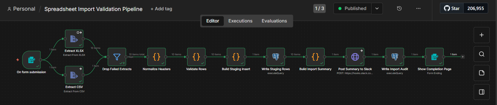
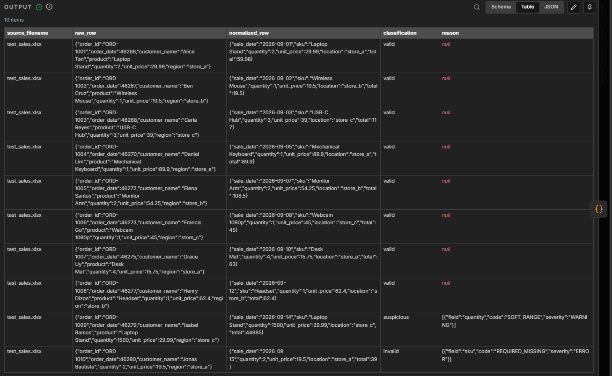
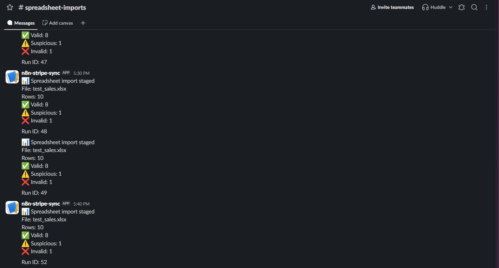
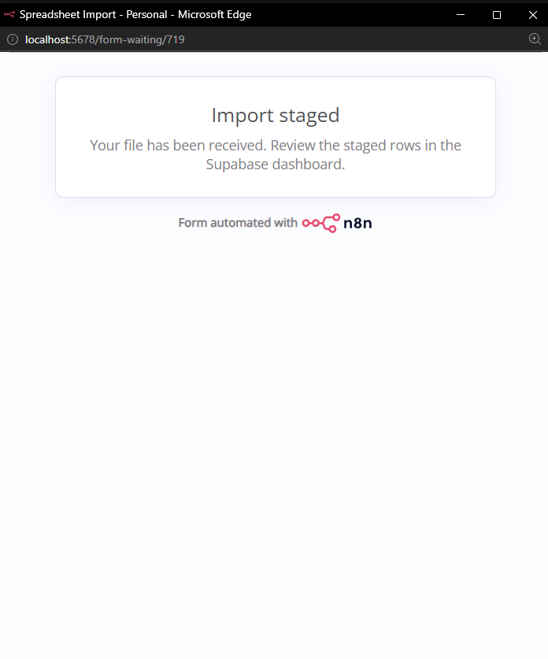
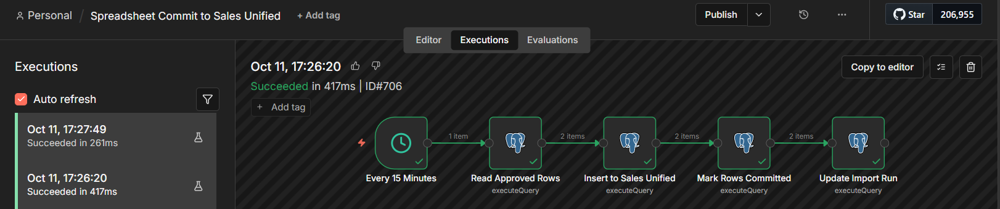
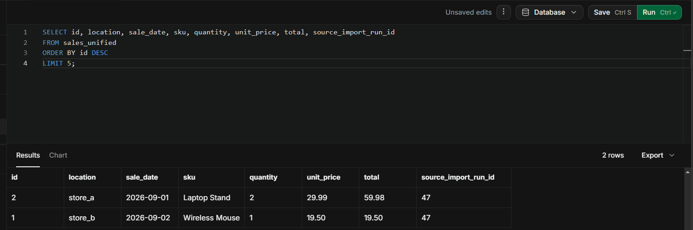
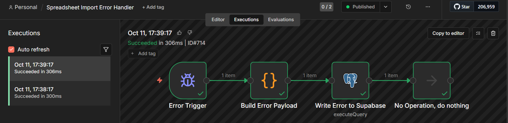

# Workflow 7: Spreadsheet Consolidation & Validation Pipeline

[← Back to README](../../README.md)

**Status:** Verified end to end. Multi-source spreadsheet ingestion, header normalization, row classification, staged review, commit workflow, and companion error handler all confirmed.

## Problem

A multi-location retail business operates three stores and receives weekly sales exports from each location's point-of-sale system. The exports arrive as XLSX files with inconsistent headers — `qty` vs `quantity`, `date` vs `sale_date`, `product` vs `sku`, `region` vs `location`. Some rows have missing SKUs, some have implausible quantities, and some use Excel serial dates instead of ISO date strings.

Loading this data directly into a consolidated sales table would corrupt reports. The workflow must:

- Accept files from any location via a web form.
- Map variant headers to a canonical schema.
- Classify each row as valid, suspicious, or invalid with a logged reason.
- Stage every row for human review before any write to the live table.
- Commit only approved rows, atomically and idempotently.

This is a data normalization problem, not an extraction problem. Workflow 6 handles PDF invoices via structured field extraction. Workflow 7 handles spreadsheets via schema mapping and validation.

## Architecture

```
Form Trigger (file upload)
│
├──► Extract XLSX ──► Drop Failed Extracts ──┐
│                                             ├──► Normalize Headers ──► Validate Rows ──► Build Staging Insert ──► Write Staging Rows
└──► Extract CSV ──► (parallel) ──────────────┘                                                                            │
                                                                                                                             ▼
                                                                                    Build Import Summary ──► Post Summary to Slack ──► Write Import Audit ──► Show Completion Page

Commit workflow (separate, scheduled):
Every 15 Minutes ──► Read Approved Rows ──► Insert to Sales Unified ──► Mark Rows Committed ──► Update Import Run

Error handler (separate):
Error Trigger ──► Build Error Payload ──► Write Error to Supabase ──► NoOp
```



## Key implementation details

### Parallel extract with error filtering

The Form Trigger accepts both XLSX and CSV files. Rather than routing by extension (which requires the `fx` toggle in an IF or Switch node — unreliable in n8n 2.8.4), the workflow runs both extractors **in parallel** and filters out whichever one failed.

- `Extract XLSX` and `Extract CSV` both receive the file binary.
- Each is configured with `On Error: Continue (regular output)`.
- Whichever extractor doesn't match the file format emits an error item on its main output.
- `Drop Failed Extracts` is a Filter node that drops items with an `error` field.
- The remaining item flows to `Normalize Headers`.

This avoids the routing bug entirely: no IF or Switch node, no conditional branch, no `fx` toggle to fight.

### Header normalization via synonym map

`Normalize Headers` maps source column names to canonical fields using a case-insensitive synonym map:

| Canonical field | Accepted source names |
|---|---|
| `location` | location, store, branch, site, region |
| `sale_date` | sale_date, date, saledate, transaction_date, order_date |
| `sku` | sku, item, product_code, item_code, product |
| `quantity` | quantity, qty, units, count |
| `unit_price` | unit_price, price, unitprice, price_per_unit |
| `total` | total, amount, line_total |

Unmapped columns are preserved in the `raw_row` JSONB field but dropped from `normalized_row`. The `source_filename` is attached to every item so it flows through to the audit row.

### Row classification

`Validate Rows` applies the canonical schema:

```javascript
location:   { required: true,  type: 'string', enum: ['store_a', 'store_b', 'store_c'] }
sale_date:  { required: true,  type: 'date' }
sku:        { required: true,  type: 'string' }
quantity:   { required: true,  type: 'number', min: 1, soft_max: 1000 }
unit_price: { required: true,  type: 'number', min: 0.01 }
total:      { required: false, type: 'number' }
```

Each row is classified:

- **valid** — all required fields present, all types pass, all ranges pass
- **suspicious** — all required present, types pass, but soft rules fail (quantity > 1000, future date, enum mismatch)
- **invalid** — at least one required field missing or a hard type mismatch

The `reason` field is a JSON array of violation objects: `[{ field, code, severity }]`.

Excel serial dates: `Validate Rows` detects numeric values in the 43000–50000 range (which covers 2020–2030) and converts them to ISO dates using the Excel epoch 1899-12-30. This handles XLSX files where the date column wasn't formatted as a date.

### Atomic insert via CTE

`Build Staging Insert` is a Code node that constructs a single SQL statement combining:

- A CTE that inserts the run row and returns its ID.
- A `LATERAL (VALUES ...)` clause that expands the staging rows.
- A single `INSERT INTO spreadsheet_staging ... SELECT` statement that references the CTE.

The result is one database round-trip, one transaction, and no possibility of an orphaned run row if a staging insert fails.

### Manual review workflow

After the import is staged, an operator reviews the rows in `spreadsheet_staging` and marks individual rows as approved or rejected. When review is complete, the operator runs:

```sql
UPDATE spreadsheet_import_runs SET status = 'reviewed' WHERE id = <run_id>;
```

The commit workflow picks up only rows where `review_status = 'approved'` and only runs when the parent run has `status = 'reviewed'`.

### Idempotent commit

The `sales_unified` table has a unique index on `(location, sale_date, sku, unit_price)`. The commit workflow uses `INSERT ... ON CONFLICT DO NOTHING`, so running it twice does not create duplicate rows. `Mark Rows Committed` runs after the insert and sets `review_status = 'committed'` on the rows that were approved, ensuring they're not picked up on the next run.

## Verified behavior

**Validation pipeline**

Upload `test_sales.xlsx` (10 rows, 3 stores, mixed classifications). Expected:

- Extract XLSX: 10 rows
- Extract CSV: 1 error item (dropped)
- Drop Failed Extracts: 10 items
- Normalize Headers: 10 items with `source_filename` and `normalized_row`
- Validate Rows: 8 valid, 1 suspicious (quantity 1500), 1 invalid (missing SKU)
- Build Staging Insert: 1 item with the full SQL statement
- Write Staging Rows: 10 rows returned
- Build Import Summary: 1 item with counts 8, 1, 1
- Post Summary to Slack: ok
- Write Import Audit: run row updated with counts
- Show Completion Page: browser shows the completion page

Run row in `spreadsheet_import_runs`:

| Column | Value |
|---|---|
| source_filename | test_sales.xlsx |
| total_rows | 10 |
| valid_count | 8 |
| suspicious_count | 1 |
| invalid_count | 1 |
| status | staged |





**Commit workflow**

Approve two valid rows, mark the run as reviewed, execute the commit workflow.

- Read Approved Rows: 2 rows
- Insert to Sales Unified: 2 rows inserted
- Mark Rows Committed: 2 rows updated
- Update Import Run: run marked committed

Idempotency: running the commit workflow again returns 0 rows from `Read Approved Rows` and inserts nothing. `sales_unified` count stays at 2.




**Error handler**

Temporarily added `throw new Error('Test error handler')` to `Validate Rows`. Triggered via a temporary Schedule Trigger (the Error Trigger only fires on scheduled or webhook executions, not form submissions).

Error handler wrote:

| Column | Value |
|---|---|
| source_filename | error_exec_711 |
| status | failed |
| error_payload | Full Error Trigger payload with execution ID and stack trace |



## Stack

n8n 2.8.4 (self-hosted, Windows) · n8n Form Trigger (file upload) · Extract from File node (XLSX and CSV) · Slack free tier (incoming webhook) · Supabase free tier (PostgreSQL 15)

## Gotchas

**n8n 2.8.4**

- The IF node's `fx` toggle is unreliable. The condition value field reverts to Fixed mode on subsequent edits, silently treating `{{ }}` expressions as literal strings. The workaround used in this workflow is to avoid IF/Switch routing entirely (parallel extracts with a filter node).
- Postgres nodes replace their input with the query result. Downstream nodes that need the upstream data must reference it by node name (`$('Node Name').all()`), not `$input`.
- Postgres nodes halt the branch when a query returns zero rows. Use `Always Output Data: ON` or redesign to avoid the zero-row case.
- `$itemIndex` is not reliably available in Code nodes across n8n versions. The atomic CTE insert avoids per-item indexing by using the `LATERAL VALUES` construct with explicit row numbers.
- Code nodes cannot easily preserve binary data. A Code node that receives an item with binary and returns a modified item will strip the binary unless it's re-attached using `this.helpers.prepareBinaryData()`. Avoid Code nodes in the binary path.
- n8n Form Trigger's file field stores binary under the Custom Field Name. With Custom Field Name `file`, the binary is at `$binary.file`, not `$binary.data`.

**Excel**

- Dates can be stored as serial numbers. Excel stores dates internally as the number of days since 1900-01-01 (with a leap year bug for 1900). A date cell formatted as a date displays `2026-09-01`, but the parsed value is `46266`. The `Validate Rows` node detects and converts serials in the 43000–50000 range.
- The XLSX 10 MB decode limit. n8n's XLSX parser rejects files whose decoded size exceeds 10 MB. The form's Accepted File Types and 5 MB cap keep this in bounds.

**Supabase**

- The `error_payload` column must exist before the error handler can write to it. Run `ALTER TABLE spreadsheet_import_runs ADD COLUMN IF NOT EXISTS error_payload TEXT;` before testing.
- The unique index on `sales_unified` is required for the `ON CONFLICT DO NOTHING` clause to work.

## Setup prerequisites

- Self-hosted n8n 2.8.4 with `NODE_FUNCTION_ALLOW_BUILTIN=crypto` set.
- Supabase project with the three tables below. Credential: Supabase Postgres v2.
- Slack incoming webhook for the summary channel.
- No paid tiers. All providers are free.

## Supabase schema

```sql
-- Import runs: one row per upload
CREATE TABLE IF NOT EXISTS spreadsheet_import_runs (
    id BIGSERIAL PRIMARY KEY,
    source_filename TEXT NOT NULL,
    total_rows INTEGER NOT NULL DEFAULT 0,
    valid_count INTEGER NOT NULL DEFAULT 0,
    suspicious_count INTEGER NOT NULL DEFAULT 0,
    invalid_count INTEGER NOT NULL DEFAULT 0,
    status TEXT NOT NULL DEFAULT 'staged'
        CHECK (status IN ('staged', 'reviewed', 'committed', 'failed')),
    committed_at TIMESTAMPTZ,
    processed_at TIMESTAMPTZ NOT NULL DEFAULT NOW(),
    error_payload TEXT
);

-- Staging rows: one row per source row
CREATE TABLE IF NOT EXISTS spreadsheet_staging (
    id BIGSERIAL PRIMARY KEY,
    import_run_id BIGINT NOT NULL REFERENCES spreadsheet_import_runs(id) ON DELETE CASCADE,
    source_row_number INTEGER,
    raw_row JSONB NOT NULL,
    normalized_row JSONB NOT NULL,
    classification TEXT NOT NULL
        CHECK (classification IN ('valid', 'suspicious', 'invalid')),
    reason TEXT,
    review_status TEXT NOT NULL DEFAULT 'pending'
        CHECK (review_status IN ('pending', 'approved', 'rejected', 'committed')),
    reviewed_at TIMESTAMPTZ,
    created_at TIMESTAMPTZ NOT NULL DEFAULT NOW()
);

CREATE INDEX IF NOT EXISTS idx_staging_run
    ON spreadsheet_staging (import_run_id);
CREATE INDEX IF NOT EXISTS idx_staging_review
    ON spreadsheet_staging (import_run_id, review_status);

-- Final sales table: written only by the commit workflow
CREATE TABLE IF NOT EXISTS sales_unified (
    id BIGSERIAL PRIMARY KEY,
    location TEXT NOT NULL,
    sale_date DATE NOT NULL,
    sku TEXT NOT NULL,
    quantity INTEGER NOT NULL,
    unit_price NUMERIC(10,2) NOT NULL,
    total NUMERIC(10,2) NOT NULL,
    source_import_run_id BIGINT REFERENCES spreadsheet_import_runs(id),
    committed_at TIMESTAMPTZ NOT NULL DEFAULT NOW()
);

CREATE UNIQUE INDEX IF NOT EXISTS idx_sales_unified_dedup
    ON sales_unified (location, sale_date, sku, unit_price);
```

## Testing checklist

- [ ] Run the schema DDL in Supabase.
- [ ] Import both workflows from the JSON files.
- [ ] Set the Supabase Postgres credential in all Postgres nodes.
- [ ] Set the Slack webhook URL in Post Summary to Slack.
- [ ] Configure the Error Workflow in Settings to point at Spreadsheet Import Error Handler.
- [ ] Upload a test XLSX with mixed rows. Verify the classification split.
- [ ] Run the SQL to approve two valid rows and mark the run as reviewed.
- [ ] Execute the commit workflow. Verify `sales_unified` receives 2 rows.
- [ ] Execute the commit workflow again. Verify idempotency.
- [ ] Trigger the error handler with a throw. Verify the error row is written.

## Roadmap

- Automated review workflow. Instead of manual SQL UPDATEs, build a second form that lists pending rows and lets the reviewer approve or reject with a click.
- Column-level schema versioning. The canonical schema is hardcoded. A production version would read it from a `spreadsheet_schemas` table so different import types can use different schemas.
- Duplicate detection within a run. If the same `(location, sale_date, sku, unit_price)` appears twice in the same file, only one row is currently inserted (the unique index prevents the second). The workflow should flag the duplicate as suspicious.
- Multi-sheet XLSX. Currently reads the first sheet only. Production would iterate sheets or accept a sheet name as a form parameter.
- Commit workflow notification. After a successful commit, post to Slack with a summary of committed rows.

## Monitored by

Spreadsheet Import Error Handler, a separate workflow linked via Settings → Error Workflow. Writes `error_exec_*` rows to `spreadsheet_import_runs` with the full Error Trigger payload in `error_payload`.

Manual executions do not fire the Error Trigger. The Form Trigger is form-submission-based, so the error handler fires only on scheduled or webhook executions. To test the error handler, temporarily add a Schedule Trigger to the main workflow.