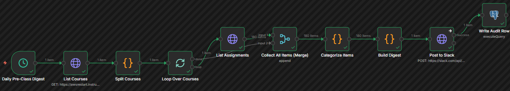
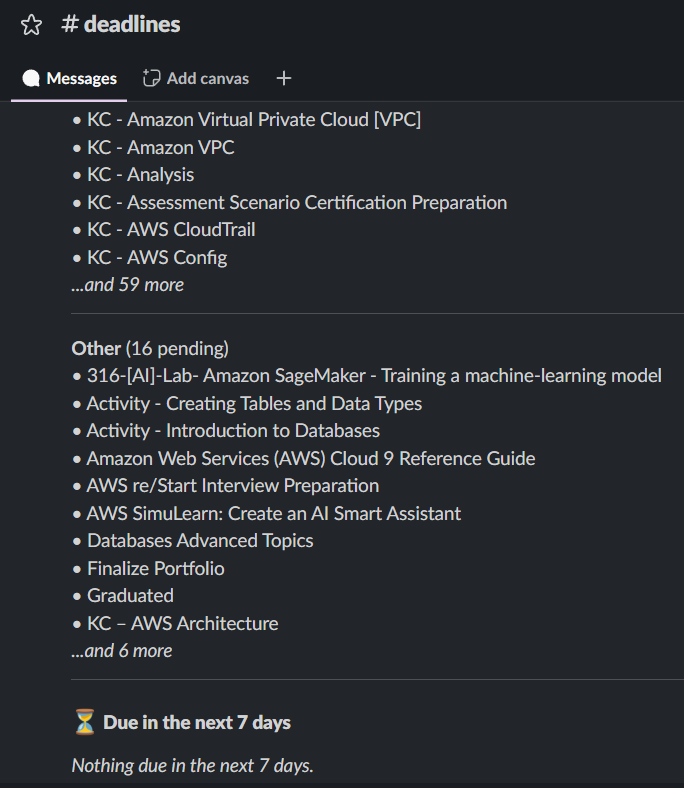
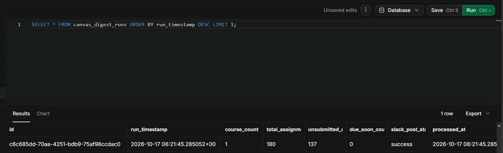
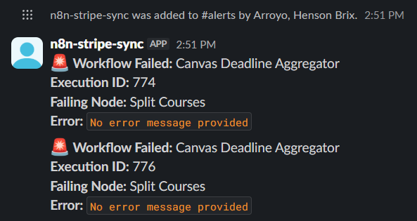

# Workflow 8: Canvas Deadline Aggregator

[← Back to README](../../README.md)

**Status:** Verified end to end. Canvas API authentication, RFC 5988 Link header pagination, fan-out-then-fan-in aggregation, and Slack Block Kit formatting all confirmed.

## Problem

A learner enrolled in a 12-week intensive cloud training program (AWS re/Start) uses Canvas LMS for graded assignments and knowledge checks. The program also includes self-paced labs. Canvas tracks the graded items, but due to the volume of assignments across multiple modules, it is easy for unsubmitted labs and KCs to pile up invisibly.

The learner also maintains a portfolio of automation workflows. Time is the scarce resource. The workflow's job is to surface what matters *before* it becomes urgent, so the learner doesn't miss a deadline while debugging a workflow.

## Architecture

```text
Daily Pre-Class Digest (17:00 Asia/Manila)
    │
    ▼
List Courses (GET /courses?enrollment_state=active)
    │
    ▼
Split Courses (Code)
    │
    ▼
Loop Over Courses (Split In Batches)
    │
    ▼
List Assignments (GET /courses/:id/assignments, paginated)
    │
    ▼
Collect All Items (Merge)
    │
    ▼
Categorize Items (Code)
    │
    ▼
Build Digest (Code)
    │
    ▼
Post to Slack (HTTP Request)
    │
    ▼
Write Audit Row (Postgres)

Error Handler (separate):
Error Trigger → Format Error Message → Post Error to Slack
```



## Key implementation details

### Fan-out then Fan-in (The Loop Pattern)

The Canvas API requires fetching assignments one course at a time. The workflow uses Split In Batches to loop over courses, and a Merge node (Append mode) to collect all the assignments after the loop finishes.

Gotcha: If you wire a Code node directly after `List Assignments`, it only processes the last course's assignments. The Merge node waits for the "done" signal from the loop and combines all pages and courses.

### Pagination

Canvas uses RFC 5988 Link headers (`<url>; rel="next"`). n8n's HTTP Request node does not parse this automatically. The node is configured with Response Contains Next URL and a regex to extract the next page:

```
{{ $response.headers.link ? ($response.headers.link.match(/<([^>]+)>; rel="next"/) || [])[1] : '' }}
```

### Categorization Logic

The Canvas assignments endpoint does not return module names. The workflow parses the assignment `name` field using regex to categorize items:

- `/-Lab/` → `lab`
- `/^KC -/` → `knowledge_check`
- everything else → `assignment`

The digest specifically filters out `knowledge_check` items from the "Exam Prep" module to avoid cluttering the list with future work.

### Slack Block Kit Formatting

The `Build Digest` node formats the Slack message into grouped sections (Linux, Networking, Security, etc.) using Block Kit. Each group is capped at 10 items to prevent Slack character limits from truncating the message, and to keep the daily digest readable on mobile.

### The API 404 Pagination Bug

n8n 2.8.4's HTTP Request node pagination logic intercepts 404/401 responses and treats them as the end of the list, preventing the workflow from throwing an error. To test the error handler, an intentional Code node exception must be used.

## Verified behavior

**Successful Run**

- List Courses: 1 active course found (AWS re/Start PHMAN31).
- List Assignments: Paginated through 180 assignment items.
- Categorize Items: Correctly tagged 180 items (labs, KCs, assignments).
- Build Digest: Grouped 137 unsubmitted items by domain and formatted the Block Kit JSON.
- Post to Slack: Message posted successfully to #deadlines.
- Write Audit Row: Supabase row inserted with `course_count: 1`, `total_assignments_scanned: 180`, `unsubmitted_count: 137`, `slack_post_status: 'success'`.




**Error Handler**

Intentionally threw an error in the `Split Courses` Code node.

- Error Handler fired automatically.
- Slack alert posted successfully to #alerts after the bot was invited to the channel.



## Stack

n8n 2.8.4 (self-hosted, Windows) · Canvas LMS API (institutional free account) · Slack API (free tier) · Supabase (PostgreSQL 15)

## Gotchas

**n8n 2.8.4**

- Pagination swallows errors: HTTP Request pagination treats 404/401 as an empty list. Workflows will show green instead of failing.
- Loop aggregation: Code nodes inside a loop only see the last iteration. Use a Merge (Append) node to collect data after the loop.
- Error Trigger only fires on production runs: Manual executions (clicking "Execute workflow") do not trigger the Error Workflow.
- `not_in_channel` Slack error: A bot token cannot post to a channel unless the bot is explicitly invited (`/invite @bot-name`).

**Canvas API**

- Link Header: RFC 5988 format requires regex extraction in n8n.
- Null due dates: Most self-paced labs and KCs do not have a `due_at` value. The workflow relies on `submission.submitted_at` to track completion.
- Module names are missing: The assignments endpoint only returns `assignment_group_id`, not the module name, requiring regex categorization on the assignment title.

## Setup prerequisites

- Self-hosted n8n 2.8.4 with `NODE_FUNCTION_ALLOW_BUILTIN=crypto`.
- Canvas API Personal Access Token (Account → Settings → New Access Token).
- Slack App with `chat:write` scope and a Bot User OAuth Token (`xoxb-...`). The bot must be invited to the target channel.
- Supabase project with the `canvas_digest_runs` table.

## Supabase schema

```sql
CREATE TABLE IF NOT EXISTS canvas_digest_runs (
    id UUID PRIMARY KEY DEFAULT gen_random_uuid(),
    run_timestamp TIMESTAMPTZ NOT NULL DEFAULT NOW(),
    course_count INTEGER NOT NULL DEFAULT 0,
    total_assignments_scanned INTEGER NOT NULL DEFAULT 0,
    unsubmitted_count INTEGER NOT NULL DEFAULT 0,
    due_soon_count INTEGER NOT NULL DEFAULT 0,
    slack_post_status TEXT NOT NULL DEFAULT 'skipped'
        CHECK (slack_post_status IN ('success', 'failed', 'skipped')),
    processed_at TIMESTAMPTZ NOT NULL DEFAULT NOW()
);
```

## Roadmap

- Module-level grouping: Fetch `/courses/:id/modules` to replace regex categorization with actual Canvas module names.
- Vocareum integration: The cloud program uses Vocareum for labs. A future version could scrape or use an API to merge Vocareum lab deadlines with Canvas assignments.
- Two-way sync: Allow marking an assignment as submitted directly from the Slack message (using Slack Interactivity).

## Monitored by

Canvas Digest Error Handler, a separate workflow linked via Settings → Error Workflow. Writes an alert to #alerts containing the workflow name, failing node, and error message.