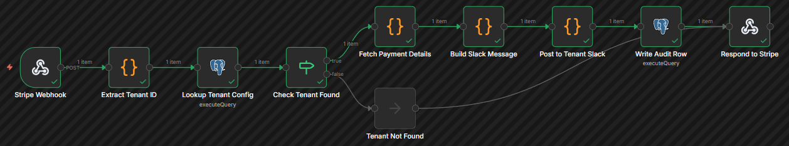
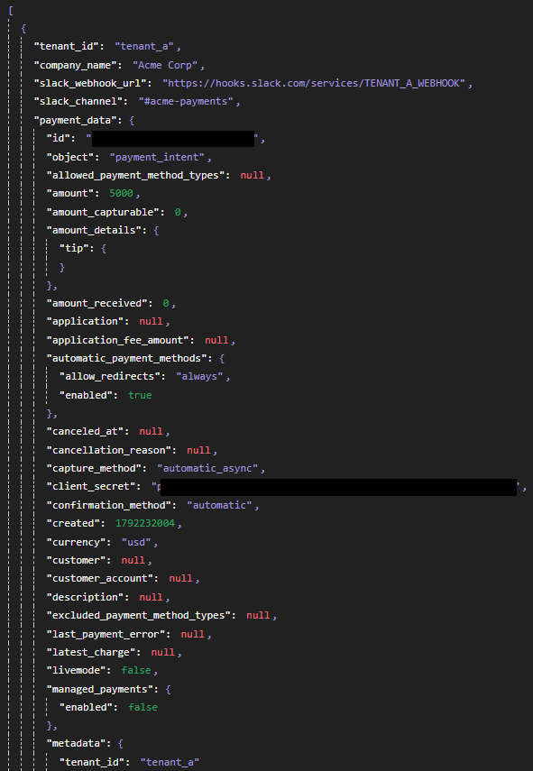
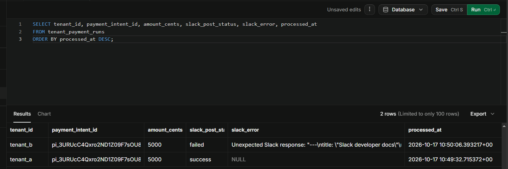
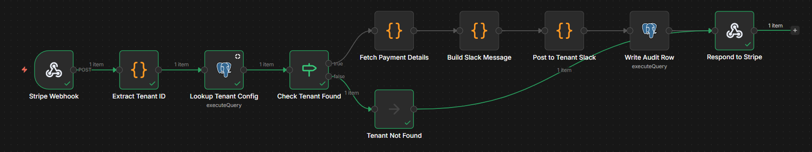

# Workflow 9: Multi-Tenant Payment Notifications

[← Back to README](../../README.md)

**Status:** Verified end to end with real Stripe Test Mode API data. Dynamic tenant routing, credential isolation, and per-tenant error handling confirmed.

## Problem

A B2B SaaS platform allows its customers (tenants) to connect their own Stripe accounts for payment processing. When an end-user makes a payment, Stripe sends a webhook to the platform. The platform must:

1. Identify which tenant the payment belongs to.
2. Fetch that tenant's specific API key and Slack webhook from a database.
3. Use the tenant's Stripe key to fetch the full payment details.
4. Notify the tenant's Slack channel.
5. Log the outcome, ensuring data is never leaked between tenants and a single tenant's failure does not crash the system.

## Architecture

```text
Stripe Webhook (POST /stripe-tenant)
    │
    ▼
Extract Tenant ID (Code)
    │
    ▼
Lookup Tenant Config (Postgres)
    │
    ▼
Check Tenant Found (If)
    ├── (True) ──► Fetch Payment Details (Code)
    │                 │
    │                 ▼
    │              Build Slack Message (Code)
    │                 │
    │                 ▼
    │              Post to Tenant Slack (Code)
    │                 │
    │                 ▼
    │              Write Audit Row (Postgres)
    │                 │
    │                 ▼
    └── (False) ──► Respond to Stripe (Respond to Webhook) ◄──┘
```



## Key implementation details

### The Multi-Tenant Credential Workaround

n8n 2.8.4 does not support dynamically swapping credentials on the HTTP Request node. Credentials are bound at design time, not runtime.

To route requests using a tenant-specific API key and Slack webhook URL fetched from a database, the workflow uses Code nodes with `this.helpers.httpRequest`. This bypasses the UI credential system entirely, allowing the API key and webhook URL to be passed in dynamically per execution.

### Graceful Error Handling per Tenant

The `Post to Tenant Slack` node is wrapped in a try/catch block. If a tenant's Slack webhook is invalid or revoked, the workflow captures the error, sets `slack_post_status: 'failed'`, and writes the audit row. The workflow finishes with a green checkmark, ensuring one tenant's broken integration does not crash the platform for other tenants.

## Verified behavior

The multi-tenant isolation was tested with three distinct tenants:

- **tenant_a (Active, Valid Config):** The workflow successfully fetched the real Stripe PaymentIntent using the tenant's API key, posted to Slack, and logged a success row in Supabase.
- **tenant_b (Active, Invalid Slack URL):** The workflow successfully fetched the real Stripe PaymentIntent, but the Slack post failed due to a dummy webhook URL. The workflow completed successfully, logging a `failed` status in Supabase with the error message captured.
- **tenant_c (Inactive):** The SQL lookup returned zero rows (due to `is_active = FALSE`), routing the workflow to the NoOp. No Stripe fetch occurred, no Slack post occurred, and no audit row was written.





## Stack

n8n 2.8.4 (self-hosted, Windows) · Stripe API (Test Mode) · Supabase (PostgreSQL 15)

## Gotchas

**n8n 2.8.4**

- Dynamic Credentials: You cannot use `$json.api_key` inside the HTTP Request node's credential configuration. You must use a Code node with `this.helpers.httpRequest` to handle multi-tenant auth.

**Stripe API**

- `whsec_` vs `sk_test_`: The webhook signing secret (`whsec_`) is for verifying incoming webhooks. The Secret Key (`sk_test_`) is for making outbound API calls. They are not interchangeable.
- `payment_method_types` deprecation: Stripe recently deprecated the ability to pass `payment_method_types` when creating a PaymentIntent via the API. Attempting to do so results in a 400 error.

## Setup prerequisites

- Supabase project with the `tenant_configs` and `tenant_payment_runs` tables.
- Stripe Test Mode account with a Secret Key (`sk_test_`).
- A Cloudflare tunnel (or similar) to expose the n8n webhook.

## Supabase schema

```sql
CREATE TABLE IF NOT EXISTS tenant_configs (
    id BIGSERIAL PRIMARY KEY,
    tenant_id TEXT NOT NULL UNIQUE,
    company_name TEXT NOT NULL,
    stripe_api_key TEXT NOT NULL,
    slack_webhook_url TEXT NOT NULL,
    slack_channel TEXT,
    is_active BOOLEAN NOT NULL DEFAULT TRUE,
    created_at TIMESTAMPTZ NOT NULL DEFAULT NOW(),
    updated_at TIMESTAMPTZ NOT NULL DEFAULT NOW()
);

CREATE TABLE IF NOT EXISTS tenant_payment_runs (
    id BIGSERIAL PRIMARY KEY,
    tenant_id TEXT NOT NULL,
    stripe_event_id TEXT NOT NULL,
    payment_intent_id TEXT,
    amount_cents INTEGER,
    currency TEXT,
    customer_email TEXT,
    tenant_lookup_status TEXT NOT NULL DEFAULT 'success',
    stripe_fetch_status TEXT NOT NULL DEFAULT 'skipped',
    slack_post_status TEXT NOT NULL DEFAULT 'skipped',
    stripe_error TEXT,
    slack_error TEXT,
    processed_at TIMESTAMPTZ NOT NULL DEFAULT NOW()
);

CREATE UNIQUE INDEX IF NOT EXISTS idx_tenant_payment_runs_event_id
    ON tenant_payment_runs (stripe_event_id);
```

## Roadmap

- Webhook Signature Verification: Currently the workflow trusts the incoming payload. A production version must verify the `Stripe-Signature` header using the tenant's specific `whsec_` secret (stored in `tenant_configs`).
- Retry Logic: If the Stripe API fetch fails (e.g., 500 error), the workflow currently logs the failure but does not retry. A queue or retry loop would be needed for production.

## Monitored by

(To be implemented: a dedicated error handler workflow for alerting on multi-tenant failures.)