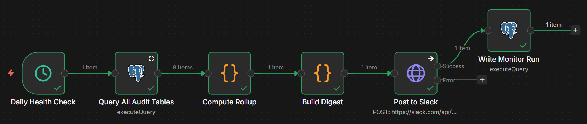
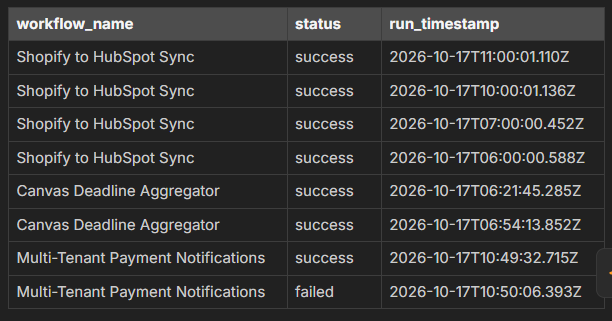
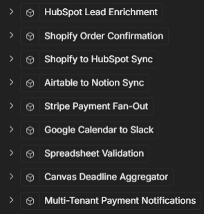
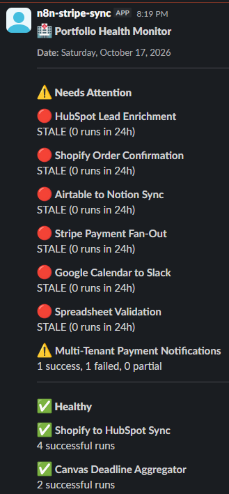
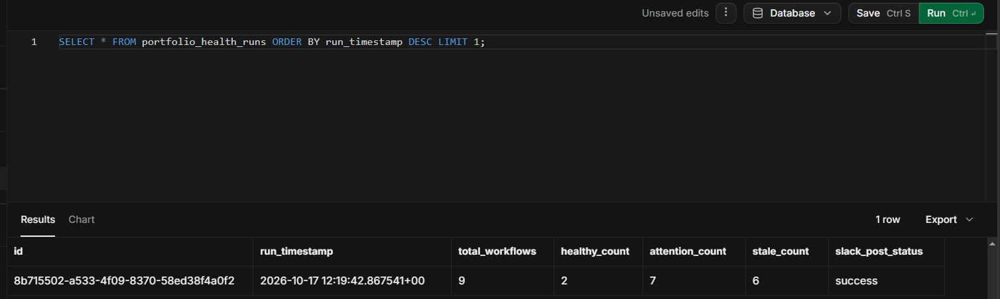
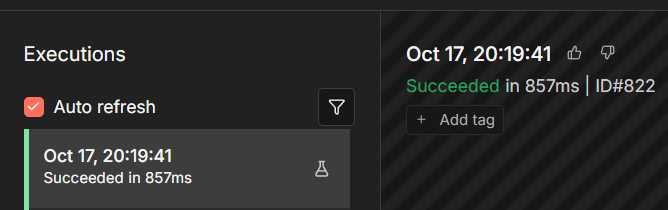

# Workflow 10: Portfolio Health Monitor

[← Back to README](../../README.md)

**Status:** Verified end to end. The monitor aggregates audit logs from all 9 previous workflows, normalizes their differing schemas, and posts a unified daily health digest to Slack.

## Problem

A portfolio of automated workflows is only valuable if it is actively running. Silent failures, revoked API keys, or broken webhooks can cause workflows to stop executing without anyone noticing.

To close out this portfolio, a "meta-workflow" monitors the health of the other 9 workflows. It aggregates audit data from separate Supabase tables (each with a different schema), checks whether any workflow has failed or gone stale (0 runs in 24 hours), and sends a daily digest to Slack.

## Architecture

```text
Schedule Trigger (daily 08:00 Asia/Manila)
    │
    ▼
Query All Audit Tables (Postgres)
    │  UNION ALL normalizes the 9 different tables
    ▼
Compute Rollup (Code)
    │  Groups by workflow, counts successes/failures, flags stale
    ▼
Build Digest (Code)
    │  Creates Slack Block Kit JSON with emoji status icons
    ▼
Post to Slack (HTTP Request)
    │
    ▼
Write Monitor Run (Postgres)
```

## Key implementation details

### Schema normalization via UNION ALL

The biggest challenge is that each of the 9 workflows logs its audit data differently:

- Workflows 1 and 2 have no status column. They log individual rows and use `error_message` to indicate failure.
- Workflow 5 uses `overall_status`.
- Workflow 6 uses `slack_post_status`.
- Timestamps are named `run_started_at`, `started_at`, `received_at`, or `processed_at`.

The **Query All Audit Tables** node solves this with a single `UNION ALL` query that normalizes everything into three columns: `workflow_name`, `status`, and `run_timestamp`.

```sql
-- Example for W1 (deriving status from error_message)
SELECT 'HubSpot Lead Enrichment',
       CASE WHEN error_message IS NOT NULL THEN 'failed' ELSE 'success' END,
       received_at
FROM lead_enrichment_runs
WHERE received_at >= NOW() - INTERVAL '24 hours'
```

### The rollup logic

The **Compute Rollup** Code node initializes all 9 expected workflows as `stale: true`. It then iterates over the Postgres results. If a workflow appears in the data, it flips `stale` to `false` and counts the successes, failures, and partials. If a workflow stops running entirely, it is flagged as stale instead of being silently omitted from the digest.

### Slack Block Kit formatting

The **Build Digest** node splits the 9 workflows into two sections:

- **Needs Attention** (⚠️ / 🔴): workflows with failures or partials, or that are stale.
- **Healthy** (✅): workflows with 100% successful runs.

## Verified behavior

During the test run, the monitor queried the database and found:

- **Healthy (2):** Shopify to HubSpot Sync (4 runs), Canvas Deadline Aggregator (2 runs).
- **Needs Attention (1):** Multi-Tenant Payment Notifications (1 success, 1 failed).
- **Stale (6):** The remaining 6 workflows had 0 runs in the last 24 hours.

The Slack message posted successfully to `#portfolio-health` with the correct color-coded emojis, and the run was logged to `portfolio_health_runs`.

Verify the saved row in the Supabase SQL Editor:

```sql
SELECT * FROM portfolio_health_runs ORDER BY run_timestamp DESC LIMIT 1;
```

Expected: `total_workflows = 9`, `healthy_count = 2`, `attention_count = 1`, `stale_count = 6`, `slack_post_status = 'success'`.

## Screenshots

### Workflow canvas


### Query All Audit Tables output
Normalized rows from the `UNION ALL` query: `workflow_name`, `status`, `run_timestamp`.



### Compute Rollup output
All 9 workflows listed, with healthy, attention, and stale flags.



### Slack digest
Needs Attention and Healthy sections posted to `#portfolio-health`.



### Audit row in Supabase


### Successful execution


## Stack

n8n 2.8.4 (self-hosted, Windows) · Supabase (PostgreSQL 15) · Slack API (Bot Token)

## Gotchas

### Supabase / SQL

- **Column mismatch errors in UNION queries:** every `SELECT` in a `UNION ALL` must have the same number of columns and compatible data types. Alias and cast missing columns where needed.
- **Empty results halt the branch:** if none of the 9 workflows ran in the last 24 hours, the Postgres query returns zero rows and n8n stops the execution. **Fix:** turn **Always Output Data** ON in the Postgres node, and make sure the Code node handles the empty case by marking all workflows stale.

### n8n 2.8.4

- **Referencing upstream nodes:** after a Postgres node, `$json` holds the query results, not the previous node's data. To read the rollup in **Write Monitor Run**, use `$('Build Digest').first().json.summary`.

## Setup prerequisites

- All 9 previous workflows are active and logging to their Supabase tables.
- A Slack App with a Bot Token (`xoxb-`) and the `chat:write` scope. The bot must be invited to `#portfolio-health`.

## Supabase schema

```sql
CREATE TABLE IF NOT EXISTS portfolio_health_runs (
    id UUID PRIMARY KEY DEFAULT gen_random_uuid(),
    run_timestamp TIMESTAMPTZ NOT NULL DEFAULT NOW(),
    total_workflows INTEGER NOT NULL,
    healthy_count INTEGER NOT NULL,
    attention_count INTEGER NOT NULL,
    stale_count INTEGER NOT NULL,
    slack_post_status TEXT NOT NULL
);
```

## Roadmap

- **Dynamic lookback window:** currently hardcoded to 24 hours. A future version could make this configurable (for example 7 days for weekly reviews).
- **Clickable links:** include links to the specific n8n execution IDs or Supabase dashboards in the Slack message for failed workflows.

## Monitored by

This is the meta-monitor and the final workflow in the portfolio.